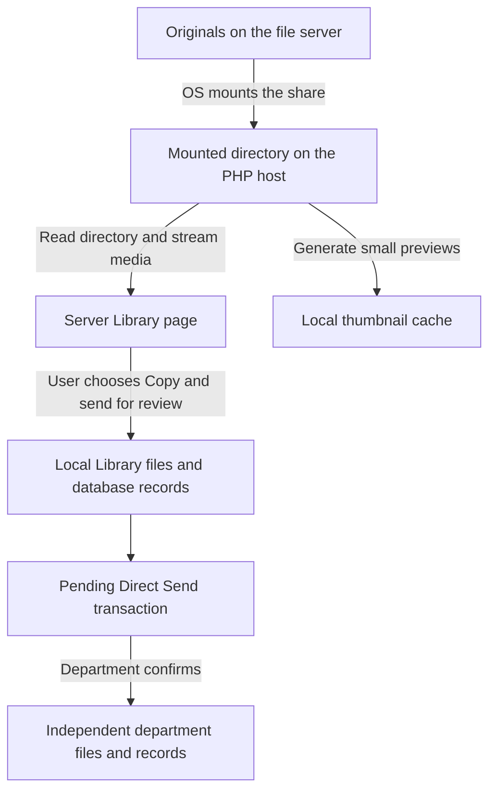

# File Management → Server Library: setup and permissions guide

Reviewed against the application code and configuration on **28 September 2026**.

Server Library lets authorized Greyhound users browse a server share through **File Management → Server Library**. Original files remain on that share. Server Library is now the default File Management destination for Creative Staff and Writers. Local Library remains available as a separate tab. The page provides browsing, previews, downloads, direct server editing, and explicit review/publishing workflows.

**Server editing requires both a Greyhound role with `files.manage` (or `files.upload` for uploads) and write permission on the mounted share.** New Folder, Upload, Rename, Tags, and deletion operate on the share. The legacy Move API remains available. Deleted server items appear in the existing Trash page alongside local items. Existing destination files are rejected rather than replaced. The application does not change share credentials, mounts, or operating-system permissions.

This guide documents setup and permission changes; writing it did not change any account, share permission, mount, or application configuration. The current server operating system and the connected share account's effective permissions have not been verified. An AFP address alone does not identify the server vendor.

## 1. How the feature was implemented

The implementation added a separate Server Library tab to the existing File Management page. It uses the same mounted source directory configured for iFound, while keeping normal Local Library storage separate.



Browsing does not register the source files in the `files` table. Only an explicit send or mobile-app post creates local file records. The server source path is not stored as the managed file path for those copies.

| Component | Responsibility |
| --- | --- |
| [ServerLibraryService.php](../app/Services/ServerLibraryService.php) | Resolves the share, rejects invalid paths, lists one folder, sorts and paginates results. |
| [ServerLibraryEditor.php](../app/Services/ServerLibraryEditor.php) | Confines direct edits, validates batches, stores tags, and manages recoverable server items in the shared Trash interface under an application write lock. |
| [ServerLibraryController.php](../app/Controllers/Web/ServerLibraryController.php) | Checks login and permissions; provides browsing, media, download, editing, Trash, send, and mobile-app post actions. |
| [ServerLibraryTransferService.php](../app/Services/ServerLibraryTransferService.php) | Validates selected files, copies them locally, creates records, and starts Direct Send. |
| [server_library.php](../app/Views/workspace/server_library.php) | Copies Local Library markup and scripts for folders, paginated files, search, selection, dialogs, and previews. ServerLibraryPresentation adapts server paths; ServerLibraryActionsController connects the forms to server operations. |
| [media.php](../app/Views/workspace/media.php) | Adds Local Library / Server Library navigation for permitted users. |
| [Storage.php](../app/Config/Storage.php) | Reads source, destination, and file-validation settings. |
| [StorageService.php](../app/Services/StorageService.php) | Checks storage separation and creates managed copies. |
| [RolePolicy.php](../app/Libraries/RolePolicy.php) | Defines Greyhound account permissions. |
| [DistributionService.php](../app/Services/DistributionService.php) | Creates the review transaction and, on confirmation, the department delivery. |
| [DepartmentLibraryService.php](../app/Services/DepartmentLibraryService.php) | Maintains independent department records. |

Browsing and direct editing require no new database table. Tags, upload passports, duplicate-queue records and Trash metadata live in the hidden `.greyhound-library` directory on the share. Sending uses the existing `folder`, `files`, distribution, and notification tables; department authorization uses the existing independent department library schema.

### Direct server editing

- **New → Upload files / Upload a folder** uses the same review queue, thumbnails, add/remove controls, progress, cancellation, and chunk retries as Local Library. The destination picker starts with the current folder, ancestors and visible subfolders. Selecting a folder loads its children on demand, so any reachable destination can be chosen without reading the entire share first. Folder uploads preserve their hierarchy. There is no application file-count limit; files are processed one at a time. `greyhound.maxUploadBytes` and available share storage still apply. Upload bytes and chunk receipts are staged under the share's private directory; completed originals stay on the share.
- Server uploads now use the same **Current upload** and **Media Library** duplicate modes as Local Library. SHA-256 and perceptual image fingerprints identify exact and visually similar copies. Current upload compares the same batch; Media Library compares files from before that batch. Matching copies are isolated under `.greyhound-library/duplicate-<id>` and displayed in the same Duplicates dialog, with selectable restore and original/copy downloads. Restoring a duplicate never overwrites an existing file. Fingerprints are cached against source size and modification time; the first scan of a large share can take time.
- New uploads receive analysis from the configured event model (80% review threshold) and a downloadable JSON metadata passport. If inference is unavailable, filename/folder keywords remain suggestions with zero confidence and require review. Tags, upload dates, analysis and passports live in share metadata; moves and Trash restores preserve them. The existing iFound scan/import workflow still manages its own review records.
- The Media Library header, New menu, file/folder counts, search suggestions, file-type menu, Apply filters, list/grid layouts, selection and file actions match the Local Library design. Submitted searches include nested server folders, names, tags, stored classifications and original dates taken. Files use the same 20-item pagination and newest-first ordering as Local Library. The upload panel, filter behavior and styles are shared view components. Local and Server upload sessions are isolated when navigating between libraries.
- **New folder** and **Rename** change actual server paths. The legacy **Move** API also changes server paths. Move accepts an existing folder path relative to Server root; a blank destination means root. Existing filenames, paths outside the share, linked paths, and moving a folder into itself are rejected.
- **Add tags** supports Enter/comma and removable chips, with 25 tags per file and 50 characters per tag. Tags are searchable in the current folder and move with items edited through this application.
- **Trash** moves selected server files/folders into `TRASH/<id>--<name>` at the creative share root. The root `TRASH` tree is reserved: normal browsing, search, uploads and media routes exclude it, and the CLI indexer removes its old catalog/queue records. Restore uses the original location, preserves tags, and refuses to overwrite a replacement. Restore a missing parent first. Server and local items share the existing Trash page, search, pagination, Restore selected, and Delete selected controls. A Server Library label identifies remote items. Permanent deletion requires `files.delete_permanently`, leaves replacement files untouched, and never follows nested symbolic links. Interrupted deletion is marked for retry instead of offering an incomplete restore. Server and local items expire after 30 days. The Trash page and `php spark trash:purge --limit 500` remove expired items; schedule that command daily to clean up without page visits. Server deletion timestamps and countdown deadlines use UTC. Items without a valid deletion date receive a persisted 30-day grace period from first detection, never from file modification time. Server cards show the remaining days and permanent deletion date. A disconnected share shows a warning without blocking local Trash.
- **Download** creates a ZIP for up to 50 selected files. The legacy **Send for review** API and the **Post** button accept up to 20 selected files and create managed copies for the existing downstream workflows. Those copies keep tags and remain independent of later edits to server originals.

The private directory also contains `metadata.json` and `edit.lock`. Back it up together with the server files; losing it loses tags, passports, duplicate-queue and Trash location records. Browsing never creates it. Writes serialize through a nonblocking application lock, metadata is replaced atomically, and caught failures attempt to undo file operations. This lock coordinates Greyhound requests, not edits made through Finder/other clients. A process crash, network loss, or external concurrent change may require recovery from the server backup. External renames are not automatically reconciled with tags.

The sidebar now opens Server Library for users allowed to view the shared library. Department accounts continue opening Authorized Files. Existing Local Library URLs and stored files remain available. iFound continues using its existing scan/import workflow; this change does not automatically index or classify every server file.

## 2. Current installation and storage locations

The following non-secret settings were checked in this project's `.env`:

```ini
greyhound.scanSourceRoot = '/Volumes/creative'
greyhound.scannerEndpoint = 'afp://10.99.10.40/creative'
greyhound.storageRoot = '/Applications/XAMPP/xamppfiles/htdocs/greyhound-admin-2025-final_greyhound_admin_2025/writable/uploads'
greyhound.departmentStorageRoot = '/Applications/XAMPP/xamppfiles/htdocs/greyhound-admin-2025-final_greyhound_admin_2025/writable/Department'
```

`scanSourceRoot` is the filesystem directory PHP reads. `scannerEndpoint` is an informational setting for iFound; Server Library does not use it to connect, authenticate, or mount anything. Changing the AFP address in `.env` alone does not connect the server.

| Content | Location and lifecycle |
| --- | --- |
| Server originals | Remain on the server, exposed locally through `/Volumes/creative`. |
| Image thumbnails | `writable/cache/media-thumbnails`; derivative images, not original copies. |
| Video posters | `writable/cache/video-previews`; this page requests JPEG posters, not full video transcodes. |
| Files explicitly sent for review | A new `Server transfers …` batch folder beneath `greyhound.storageRoot`. |
| Authorized department copies | Beneath `greyhound.departmentStorageRoot`, organized by the existing department delivery workflow. The configured directory is `Department` with a capital D. |
| Downloads | Written to the browser user's selected download location. |

Browsing uses local space for caches. Sending uses local space for full review copies; confirmation uses additional space for department copies. These copies remain after the share disconnects. There is no automatic synchronization of later source edits into existing copies, and no automatic removal of review copies after confirmation.

## 3. Set up the connection

### Prerequisites

Use the existing working Greyhound installation, its database, and its normal migrations. A fresh deployment should follow [README setup](../README.md) and [independent department library deployment](independent-department-library.md) first. Do not re-import a database schema over an existing installation merely to enable Server Library.

The PHP host needs network access to the share, a valid share account, and permission to read files and traverse folders. PHP also needs write access to its local cache, upload, and department destinations. Image thumbnails use PHP GD; video posters use FFmpeg. Missing preview support does not grant write access to the server.

### Mount the share on the machine running PHP

1. On the Mac that runs Greyhound, open Finder → **Go → Connect to Server** (`Command-K`).
2. Enter the existing address `afp://10.99.10.40/creative`, if that service is available. If the server administrator provides SMB instead, use their SMB address, such as `smb://10.99.10.40/creative`.
3. Connect with the intended file-server account and select the shared folder.
4. Confirm the actual mounted directory. Do not assume it is always named `creative`; a second connection can receive a different mount name.

These are client connection steps, based on [Apple's server connection guide](https://support.apple.com/guide/mac-help/connect-mac-shared-computers-servers-mchlp1140/mac). Mounting the share on a different laptop does not make it available to the Greyhound PHP host.

A read-only inspection from Terminal is:

```sh
ls -ld '/Volumes/creative'
mount | grep -F '/Volumes/creative'
```

These commands inspect the path and mounts; they do not change files. A successful Terminal check proves access for that Terminal user, not necessarily for Apache. Inspect the account running the active PHP service when diagnosing differences. The local development launcher [serve-local.sh](../scripts/serve-local.sh) runs PHP as its launching user; XAMPP Apache can run under a different account.

Do not create an empty `/Volumes/creative` directory to hide a missing mount. The application checks whether the configured directory exists and is readable; it does not independently authenticate the remote server or prove that an existing directory is a live network mount.

### Configure Greyhound

Edit the existing `.env` entries without replacing unrelated database or application settings. This equivalent example keeps managed storage relative to the project root:

```ini
greyhound.scanSourceRoot = '/Volumes/creative'
greyhound.scannerEndpoint = 'afp://10.99.10.40/creative'
greyhound.storageRoot = 'writable/uploads'
greyhound.departmentStorageRoot = 'writable/Department'
```

Use an absolute mounted directory for `scanSourceRoot`. Do not put `afp://...` or `smb://...` in that setting. Upload and department storage may use project-relative paths. Keep both destinations outside the source tree and keep the source outside both destination trees; transfers reject overlapping roots.

Restart the active PHP/Apache service after changing environment settings if configuration remains cached. When using the project's development launcher, stop its current process before restarting it with:

```sh
sh scripts/serve-local.sh
```

Do not start a second listener on the same port. Then sign in and open **File Management → Server Library**, or `/workspace/server-library` under the normal application base URL.

Changing `scanSourceRoot` also changes the source used by iFound. Settings such as `scanBatchSize` and `maxScanFiles` control iFound, not the Server Library listing.

## 4. Use the page

1. Use **New** for folders, files, or folder uploads. The upload queue, duplicate-mode switch, cancellation, and progress controls match Local Library.
2. Open folders using their cards or list rows; use **Root Library** and the breadcrumb links to navigate back. Folder menus offer Rename and Delete. Counts load near the visible area, with at most two concurrent reads, and cancel when leaving the page.
3. Search filenames, folders, original dates, classifications/events, and tags using suggestions, Enter, or **Apply filters**. Search includes nested folders. Use the same file-type dropdown and list/grid switch as Local Library.
4. Files appear 20 per page, newest first. All matching folders remain visible on every page. Selection is shared between list and grid representations and applies to the current page.
5. Use **Post**, **Tags**, **Download**, and **Trash** on the selection toolbar. Post uses the same confirmation dialog and derives the initial post title from the first selected filename; app admins can edit the staged post. Downloads and previews never alter originals.
6. Image previews support previous/next arrows, keyboard navigation, counts, original downloads, and **Choose logo & download**. Server watermarking copies the existing watermarking screen and creates temporary download files. Video previews use the existing compatible-preview cache when needed.
7. Open **Duplicates** to review exact/visual matches and restore selected copies. Server items use the existing shared Trash page for recovery.
8. Refresh or navigate to see external share changes. The Storage: Server label and connection badge identify the mounted share. Connection and read/write access are checked when the page loads, every 15 seconds, and with Refresh connection. Checks use the PHP host’s current share access and the signed-in user’s application permissions. An unsuccessful check shows unverified access; a confirmed reconnection refreshes the listing. Uploads and server edits remain guarded by server-side permissions. Disconnection also produces an error in the alert area; there is no separate loading panel or Load more button.

Names rejected by server path validation, symbolic links, hidden/system entries, and unreadable entries are skipped consistently in listings, counts, and duplicate scanning. One unsupported entry must not block the rest of the share; direct requests for invalid paths remain rejected.

Local Library's page is unchanged. Both libraries use the shared media styles, upload queue, search, filter, and confirmation components. Server path identifiers are encoded for item routes and decoded only before the existing confinement checks; local numeric IDs are never used for server actions.

## 5. Copy and send files to a department

The former Copy & send toolbar is no longer displayed because it is absent from Local Library. The authenticated `POST /workspace/server-library/send` compatibility endpoint still accepts `paths[]` and `department` for existing integrations. It creates managed copies and invokes the existing department review workflow. The page's **Post** button stages selected photos/videos for the mobile-app publishing workflow.

Selection is retained when loading more files, but not when changing folders or submitting a search. **Select all** only includes loaded files; newly appended files start unselected. Repeating a completed send creates another batch; there is no content-based deduplication in this transfer service. Folder hierarchy from the remote share is not recursively imported: selected files go into one local batch folder. Files must satisfy `Storage::allowedMimeTypes()` and `greyhound.maxUploadBytes()`; zero for the size limit means no application-level per-file cap, not unlimited disk space or execution time.

The transfer owns a database transaction. On a caught failure, it rolls back nested assignment work and removes newly created local copies; an empty local directory may remain. A process crash or forced termination can interrupt that compensation, so inspect failed batches before retrying. Server originals are never rollback targets.

Deleting a managed admin copy does not delete the independent, authorized department copy or the server original. See [department lifecycle documentation](independent-department-library.md).

## 6. Understand the three permission layers

| Layer | Account or setting | What it controls |
| --- | --- | --- |
| Greyhound application | User record and `RolePolicy` | Who may browse the Server Library and send copies. |
| File server | Account used to connect to the share; share and filesystem permissions | Whether that connection can read or modify the originals. |
| PHP host | PHP/Apache process user and mount access | Whether the running web service can access the mounted directory and write local destinations. |

All Greyhound users accessing this feature use the PHP host's mounted connection. The application does not open a different share session for each Greyhound login. Any user with `files.view_all` can request items readable through the configured source root; there is no per-Greyhound-user subfolder permission mapping in this feature.

**No server account or share permission is automatically configured by the feature.** A read-only mounted account can browse and copy out. Direct editing needs a writable root for private metadata plus permission on each affected source and destination folder.

### Greyhound role permissions

| Greyhound role | Browse, preview, download | Copy and send for review | Edit server originals here |
| --- | --- | --- | --- |
| Super Admin | Yes | Yes | Yes, with share write access |
| Admin / Creative Staff (`admin`, legacy `staff`) | Yes | Yes | Yes, with share write access |
| Writer | Yes | No | No |
| Department | No; uses its authorized department library | No | No |

To give a Writer access to managed-library operations and sending, a **Super Admin** opens **Admin Control Center → team account → Edit account**, selects **Admin (Creative Staff)**, and clicks **Save changes**. This grants the broader Admin role, not just a single transfer permission. Active account roles are refreshed by `AccountActiveFilter` on subsequent workspace requests. Reopen the page after the change.

This action does not alter AFP/SMB permissions. Server edits reuse `files.manage` and `files.upload`; there is no additional `.env` permission switch.

## 7. Change a file-server account from read-only to read/write

Make this change on the computer or NAS that **hosts the shared folder**. The Greyhound web host may be only its client. You need administrative access to that server and must identify the account actually used by the mounted connection.

Choose only the procedure matching your server below. The server type has not been confirmed for this installation. Save the current account/group permission settings first so you can restore them. Grant access to the named account and intended folder, rather than changing access for everyone.

Read/write access can allow changes to originals through Finder or other tools using that account. Depending on the server's permissions, it can also allow deletion. The permission change itself does not delete files, but it removes the server-side protection against those later operations. Browsing and copying out through Greyhound work with read-only source access; they do not require this upgrade.

### A. If the share is hosted by a Mac

On the **host Mac**:

1. Open **System Settings → General → Sharing** and the details for **File Sharing**.
2. Select the actual shared folder in **Shared Folders**.
3. Select the connecting account in **Users**, adding it if necessary.
4. Change its permission from **Read Only** to **Read & Write**, then finish with **Done**.
5. Reconnect the client share and verify access using a disposable file.

To reverse it, return that account to **Read Only** and reconnect. Apple documents these choices in [Set up file sharing on Mac](https://support.apple.com/guide/mac-help/set-up-file-sharing-on-mac-mh17131/mac). Older macOS versions use different settings layouts. Changing Sharing settings on a client Mac does not change permissions on a NAS or another host.

### B. If the share is hosted by Synology DSM

Sign in to DSM as a server administrator. Open **Control Panel → Shared Folder**, select the share, and open **Edit → Permissions**. Choose the appropriate local or domain user list, locate the connecting account, set **Read/Write**, and save. Inspect group permissions and any file/subfolder ACLs if access still fails. Synology documents permission priority as **No access > Read/Write > Read only**. Reconnect the client to retest. Restore the previous entries to undo the change. See [shared-folder permissions](https://kb.synology.com/en-global/DSM/help/DSM/AdminCenter/file_share_privilege?version=7) and [Synology ACL guidance](https://kb.synology.com/en-eu/DSM/tutorial/How_to_manage_ACL_settings_on_your_Synology_NAS).

Other NAS products have their own user/share permissions screens. Use their administrator interface rather than assuming DSM instructions apply.

### C. If the share is hosted by Windows

On the hosting server, open the shared folder's **Properties**. Check both the **Sharing** permissions and the **Security** filesystem permissions for the connecting account. For normal read/write and file management, the administrator commonly grants **Change** at the share and **Modify** on the intended filesystem folder. Review inherited permissions and deny entries; granting one layer does not grant the other. Reconnect the client afterward. Restore the prior entries to revert. Microsoft's [access-control overview](https://learn.microsoft.com/en-us/windows/security/identity-protection/access-control/access-control) and [share/NTFS guidance](https://learn.microsoft.com/bs-latn-ba/iis/web-hosting/configuring-servers-in-the-windows-web-platform/configuring-share-and-ntfs-permissions) describe these separate controls.

Modify includes deletion; use a tailored ACL if creating files without deletion is the actual requirement.

### D. If the share is hosted by Linux/Samba

Have the Samba administrator edit the existing share configuration. A targeted example is:

```ini
[creative]
    path = /srv/shares/creative
    read only = yes
    write list = greyhound_editor
```

The path and account are examples. `write list` grants selected users read/write access despite the share's `read only` setting. The account must also be admitted by the share's access rules and have the underlying filesystem permissions. Preserve existing configuration, validate it with `testparm`, reload the correct Samba service, and reconnect clients. Restore the previous configuration and filesystem permissions to undo the change. See the official [smb.conf manual](https://www.samba.org/samba/docs/current/man-html/smb.conf.5).

Do not replace the entire share configuration with this snippet or apply recursive `chmod 777`; those changes are broader than granting access to one account.

### Reconnect and verify the intended account

Close files and let active transfers finish before disconnecting the share. Eject the existing connection on the PHP host, then reconnect as the intended server account. A remembered login may select a different account; confirm the credentials used. Keep passwords out of this repository and out of URLs or shell commands.

If the mount returns at a different directory, update `scanSourceRoot` to the actual mount and refresh the application. A connection explicitly mounted read-only must also be re-established with appropriate mount options before write access can work.

Test write access from Finder or a server administration tool using a **new disposable file in an agreed test folder**: create it, read it, edit it, and remove only that test file if deletion is intended. Do not test on an existing photo. Then verify browsing and previews from Greyhound under the actual PHP service. Then use New folder, Upload, Rename, and Trash in Greyhound with disposable test content to verify the actual PHP service account.

For rollback to read-only, restore the saved share/filesystem permissions and reconnect. Check all applicable groups or exceptions; changing one direct user entry may not remove rights granted elsewhere.

## 8. Endpoint and configuration reference

All endpoints require a signed-in user with `files.view_all`, with the normal active-account filter on workspace routes.

| Method and path | Inputs | Behavior |
| --- | --- | --- |
| `GET /workspace/server-library` | `folder`, `q`, `type`, `page` | Catalog matches, 40 files/folders per page; SQL search, metadata/type filters, and clamped `page`. |
| `GET /workspace/server-library/files` | `folder`, `q`, `type`, `offset` | JSON containing rendered file cards, `file_total`, and nullable `next_offset`; 30 files per batch. |
| `GET /workspace/server-library/folders` | `folder` | Immediate child folders for the upload destination picker; loaded on demand. |
| `GET /workspace/server-library/suggestions` | `folder`, `q`, `type` | Up to eight suggestions for the current folder and extension filter. |
| `GET /workspace/server-library/upload/token` | None | Upload permission, current CSRF token, configured size limit and safe chunk size. |
| `POST /workspace/server-library/upload` | File or chunk, destination/relative path, batch, CSRF | Shared upload protocol; supports cancellation and idempotent chunk receipts on the share. |
| `GET /workspace/server-library/passport` | `path` | Downloads the new upload's stored JSON metadata passport. |
| `POST /workspace/server-library/duplicates/restore` | `duplicate_id`, CSRF | Manager keeps the queued copy without overwriting an existing file. |
| `GET /workspace/server-library/counts` | `folder` | JSON immediate visible file/folder counts, cached for 180 seconds after path and connection validation. |
| `GET /workspace/server-library/status` | None | JSON `connected` boolean based on readable source-root availability; uncached. |
| `GET /workspace/server-library/media` | `path` (or manager-only `duplicate` ID); optional `thumbnail=1` or `download=1` | Thumbnail, inline media stream with byte-range support, or attachment. |
| `POST /workspace/server-library/edit` | `action`, `folder`, `paths[]`, action fields, CSRF token | Upload, create-folder, rename, move, tags, trash, or restore. Checks application permission and filesystem boundaries. |
| `GET /workspace/server-library/trash` | None | Compatibility redirect to the existing `/workspace/trash` page. |
| `GET /workspace/trash` | `q`, `type`, `page` | Shows local and server items together; server items remain physically on the share. |
| `POST /workspace/trash/bulk-restore` or `bulk-delete` | `file_ids[]`, `folder_ids[]`, `server_ids[]`, CSRF token | Runs the selected action on each item’s original storage with the existing role checks. |
| `GET /workspace/server-library/download-selected` | `paths[]` | ZIP of up to 50 selected files; checks all paths before preparing the archive. |
| `POST /workspace/server-library/post` | `paths[]`, `display_title`, `description`, CSRF token | Copies up to 20 photos/videos into the existing mobile-app review workflow. |
| `POST /workspace/server-library/send` | `paths[]`, `department`, CSRF token | Requires `files.assign`; copies selected files locally and submits Direct Send. |

Media and folder inputs are relative to the configured root. Absolute paths, traversal segments, hidden path segments, and linked source paths are rejected. Routes are defined in [Routes.php](../app/Config/Routes.php).

| Setting | Default | Effect |
| --- | --- | --- |
| `greyhound.scanSourceRoot` | `WRITEPATH/scan-inbox` | Directory read by Server Library and iFound. Server Library never creates it. |
| `greyhound.scannerEndpoint` | Empty | iFound origin label; no Server Library connection behavior. |
| `greyhound.storageRoot` | `writable/uploads` | Full local copies made for review. |
| `greyhound.departmentStorageRoot` | `writable/Department` | Full authorized department copies. |
| `greyhound.maxUploadBytes` | `0` | Maximum source-file size allowed by the managed copy helper; zero disables this size cap. |

The page keeps folders unpaginated and shows 20 files per page. The legacy `/files` API retains its 30-file batches. The batch size and three-minute count TTL are constants in `ServerLibraryService`; its 20-file transfer limit is separate from browsing. There is no environment setting for source write access, share username, share password, or polling interval. Configure share credentials and filesystem write access on the host/server; application actions cannot grant these permissions.

## 9. Troubleshooting

### Loading and cancellation

Server Library now uses Local Library's page navigation and upload progress controls. Folder counts load lazily, two requests at a time, with a 12-second browser timeout. Leaving the page aborts pending count requests and disconnects the observer. PHP browsing/counting retains its cooperative ten-second read budget; a blocked operating-system network read cannot be interrupted by browser cancellation. Originals remain on the share.

| Symptom | What to check |
| --- | --- |
| Connection checks keep timing out | Use `sh scripts/serve-local.sh` instead of a single-worker `php spark serve` on macOS/Linux. Stop the existing listener first. Thumbnail/stream requests can otherwise block status checks. A timeout alone does not prove the share disconnected. |
| “Server disconnected” | Mount the share on the PHP host, verify the exact path and PHP user's read/traverse access. Do not create a replacement mount folder. |
| Finder works but Greyhound fails | PHP/Apache may run as another account or lack access to that user's mount. Check the actual service identity and macOS access restrictions. |
| Connected but empty | Clear search, open Server root, inspect hidden/link-only contents, and verify the mount is really the intended share. |
| Some subfolders fail | Root readability does not prove access to every child. Review that folder's permissions on the server. |
| Broken thumbnails | Check source readability, MIME/format, GD or FFmpeg, local cache permissions, and `writable/logs`. Images above the thumbnail service's 40-million-pixel limit cannot be resized there. |
| Video poster works but playback fails | Browser codec/container support differs; download the original. The compatible video-preview cache requires FFmpeg/FFprobe. |
| No Post/Tags/Trash controls | These require `files.manage`. Writers retain browse/download access. The former Send toolbar is intentionally absent to match Local Library. |
| Copy/send fails | Check source connection, allowed MIME and size, local disk space and write permissions, database availability, and non-overlapping storage roots. |
| Permission changed but still read-only | Verify the connected account, reconnect the share, and inspect share permissions, filesystem ACLs, group rules, and mount options. |
| Read/write granted but no editing buttons | Sign in with a Creative Staff/Admin role. Writers remain read-only. Refresh the page after changing account permissions. |
| Newly added source files do not appear | The background indexer must discover the files first; catalog pages then show them automatically. |
| Source file changes but department copy does not | Copies are independent snapshots. Submit a new copy through the review workflow if required. |
| Slow folder or transfer | Listing enumerates the current folder; originals and first previews travel over the network. Transfers run synchronously in one request. Check share latency, folder size, PHP/web timeouts, and worker availability. |

Application failures are logged under `writable/logs`; transfer failures use the message prefix `Server Library transfer failed:`. This feature does not keep a dedicated audit history of every remote browse or download.

## 10. Verification and maintenance

Focused automated checks use temporary share fixtures and an in-memory database:

```sh
php vendor/bin/phpunit --no-coverage --no-logging --filter 'ServerLibrary'
node --test tests/js/server-library.test.cjs tests/js/server-library-edit.test.cjs
```

Tests cover confined paths, server edits, duplicate modes and restore, 20-file pagination, nested search, rendered layout parity with Local Library, copied interaction scripts, list/grid selection, preview navigation and cleanup, cancelled folder counts, watermark downloads, and permissions. They use disposable share fixtures. They do not validate a live NAS connection or replace visual browser acceptance.

For manual acceptance, compare both tabs at the same viewport in grid and list views, exercise the matching menus/dialogs, navigate folders and pages, search and filter, and upload disposable files in both duplicate modes. Confirm server originals stay unchanged after preview/download and can be restored after Trash. Posting creates real managed copies; verify that workflow using agreed test content.

Back up the server originals through the server's normal backup process. Back up local media, department storage, and the application database together for managed-copy recovery. Thumbnail caches can be regenerated while sources remain accessible. Review the share account's permissions separately from Greyhound account roles when access requirements change.

Related documentation: [iFound scanner](server-file-scanner.md), [storage paths and deletion](storage-paths-and-deletion.md), [independent department library](independent-department-library.md), and [local server performance](local-server-performance.md).
## Database catalog and background indexing

The indexer keeps a directory stream open across its 100-entry database checkpoints,
so large folders are read sequentially rather than reread from the beginning for
every batch. Queue priorities are still checked between batches. On interruption
or a switch to another queued folder, the handle is closed; reopening a folder
replays its saved offset once. This preserves the existing resume and failure
behavior without changing the database schema or batch size. A running worker
uses the updated implementation on its next process start. The server share must
remain connected; this optimization cannot bypass a disconnected mount.

Server Library pages, folder navigation, suggestions, and folder counts now query
`server_library_index` in local MariaDB. Each opened page or folder starts one
asynchronous server connection/access check and shows “Checking…” until it finishes.
This does not delay catalog rendering or refresh the page. There is no recurring
connection polling; Refresh connection remains available for retries. A failed
check leaves previously unverified upload access available, with access validated
when saving. No live directory scan or automatic page replacement runs during
browsing. Preview/download/edit/post
operations still resolve authorized paths on the NAS. Thumbnails may read NAS
media on demand. Source files are never copied by the indexer.

Install using `php spark migrate`, then run:

```sh
php spark server-library:index
php spark server-library:index --status
# Optional bounded run; the next invocation resumes saved progress:
php spark server-library:index --seconds 60
# Restart a failed scan after a directory was moved/removed:
php spark server-library:index --restart
```

The command catalogs paths, file sizes (BIGINT), times and supported metadata,
with a persistent breadth-first directory queue and 100-entry transactions.
A process lock prevents overlapping scans of the same source on this host.
Only a fully successful pass removes entries not seen during that pass. Errors
or disconnections preserve existing records. A scan reads filesystem metadata,
not video/image content. Directory changes during a scan are reconciled again
on subsequent passes; this is not a filesystem snapshot.

Results are stable until the user navigates, submits a search, or clicks
**Refresh results** (automatic result updates are also enabled). During the first scan, the page labels results incomplete.
Later scans retain the previous catalog until entries are refreshed. Changes
made outside the app are reflected by the next scan; opening
an outdated result safely checks the actual file. The last successful scan time
and worker state are shown on the page. Directory listing and search use
40 entries per page, including folders. Substring search uses an escaped LIKE
query; it avoids NAS I/O but is not guaranteed to be under 50 ms for millions
of rows. Measure database search before adding a full-text/token index.

On this Mac, `deploy/com.greyhound.server-library-index.plist` runs a background
Spark worker on load and hourly using launchd. It resumes interrupted scans;
interrupted passes resume their checkpoints on the next run, and launchd does not start a second copy of a running job. It runs as the logged-in
user so it can access their mounted `/Volumes/creative` share. Logs go to
`writable/logs/server-library-catalog.log`. The machine must be awake and the
share mounted; a failed job retries at the next hourly interval.

For a Linux cron deployment, use absolute paths for PHP and the project:

```cron
0 * * * * cd /path/to/greyhound && /usr/bin/php spark server-library:index >> writable/logs/server-library-catalog.log 2>&1
```

The earlier request-driven cache index remains only as a legacy service helper;
production browsing routes use `ServerLibraryCatalog` and do not call it.

### Catalog recovery

Successful folder creation and uploads publish the saved paths and their parent
folders directly to the catalog. They do not wait for the hourly indexer. If a
catalog write fails after the original is saved, it is logged for recovery;
the upload is not reported as failed or repeated. Other edits still rely on
their existing catalog updates or a later scan.

To add an existing folder and its immediate contents to the catalog without a
whole-share scan, run `php spark server-library:index --refresh-folder 'Folder name'`.
This reads existing originals and updates only the local catalog. It does not
delete stale entries or recurse into child folders.

An unreadable or moved directory is deferred while other queued directories
continue. Its checkpoint remains available; existing catalog entries are never
pruned after a partial scan. After all readable directories are processed, the
scan is marked `partial`; the next scheduled pass starts a fresh reconciliation
to discover renamed directories. Database failures or share disconnections
preserve the queue and resume it on the next run. MySQL connections are reopened
after NAS reads, outside transactions, to avoid using an expired connection.
Folders awaiting indexing show an incomplete-catalog notice, not an empty-library
message. Filesystem operations still validate actual paths on the share.

Opening a folder that is still in `server_library_scan_queue` raises its priority in the local database. The CLI worker reads those folders before the ordinary scan queue, so browsing does not have to wait for the entire initial scan. This does not perform NAS reads during HTTP browsing or reload the page automatically: newly indexed contents appear automatically while the page is idle. Apply the queue-priority migration with `php spark migrate`; restart any existing CLI worker to load the new scheduling logic.

Catalog pages check local database results every five seconds during indexing and every thirty seconds when idle. Only the result regions update; navigation, open dialogs, selections, and form editing are protected. A loading indicator explains pending indexing, and failed checks retry without removing existing results. Refresh results remains available as a manual fallback.

### Keeping navigation responsive during slow NAS reads

The token-based preview route validates path syntax without accessing the NAS; the media handler releases the session lock before resolving the source. This prevents an image request from serializing navigation and catalog updates behind network filesystem reads. Catalog pages load at most two visible thumbnails at once. Unchanged catalog polls return HTTP 204 without rendering the full page, and completed folder listings use the slower polling interval even while the rest of the NAS is being indexed. These changes reduce request contention; they cannot remove delays in the NAS mount itself.

Video cards also use queued JPEG thumbnails. They do not preload video metadata:
the compatible-video endpoint may transcode the whole file, which can occupy all
HTTP workers and make catalog updates time out. Full video preparation starts
only when the user opens a video for playback.

Open-ended video byte ranges are served in at most 4 MiB chunks so each request
releases its HTTP worker between playback reads. Explicit ranges and original
downloads retain their requested behavior. Media streaming temporarily removes
PHP's page execution deadline and flushes output as it is sent, avoiding the
30-second cutoff on slow transfers; the previous limit is restored afterwards.
This does not increase NAS throughput or eliminate first-play conversion time.


### Camera image previews

Server Library recognizes CR2, CR3, CRW, NEF, NRW, ARW, SR2, DNG, ORF,
RW2, RAF, PEF, TIFF, HEIC/HEIF, AVIF and BMP as previewable images, alongside
JPEG/PNG/GIF/WebP. On macOS, `/usr/bin/sips` produces cached JPEG derivatives
(400-pixel thumbnails and 1600-pixel previews). Actual RAW decoding depends on
the camera models supported by the installed macOS version. Conversion has a
15-second process deadline and does not wait on another request's conversion lock.
Original files are unchanged; Download still returns the original camera file.
Watermark editing retains its existing supported formats. Other operating systems
need an image-converter implementation before these additional previews can work.

### Server TRASH integration

The shared Trash page lists app-tracked entries in the creative server `TRASH` directory and preserves compatibility with older `.greyhound-library/trash-<id>` entries. Metadata remains in `.greyhound-library/metadata.json`; keep that metadata when backing up Trash, because it records original paths and tags. New deletion updates remove affected local catalog entries immediately. Restoration queues the original parent folder for priority indexing.

Files or folders moved into `TRASH` outside Greyhound appear as untracked server items. Their deletion date and original location are not guessed. Use the destination field on the Trash page before Restore selected (blank means the creative share root); this field affects only untracked entries. Existing destination names are never overwritten. Nested symlinks are never traversed during permanent deletion, and a linked `TRASH` root is rejected. No server originals were moved or deleted as part of installing this integration.
